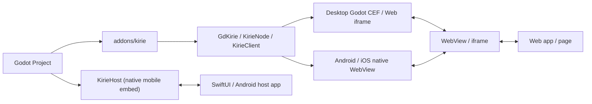

<p align="center">
  
</p>

# godot-kirie

Kirie is an experimental Godot application framework built around a low-level WebView addon and an explicit IPC core. Projects run either as Godot-owned applications on desktop, mobile, and Web, or inside native SwiftUI and Android shells that embed Godot. Higher-level Eventa RPC, host capabilities, and build automation live in separate packages above the core bridge.

## Installation

CLI-managed projects declare targets and plugins in `kirie.config.ts`. Import `kirie/plugin/webview` in `kirie.config.ts`, add `webview({ root: "./src-web" })` to `plugins`, and install the WebView addons:

```sh
pnpm kirie doctor --fix plugin:webview
```

That command downloads `addons/kirie` and, when `targets.desktop` is present, downloads the pinned desktop `addons/godot_cef` backend. After `kirie init`, run `pnpm install` and `pnpm kirie doctor --fix` in the generated project directory.

For manual WebView addon installation, download `kirie-addon.zip` from a GitHub Release asset and extract it into the Godot project root:

```text
res://addons/kirie/
```

If the project already contains an `addons` directory, merge the extracted `addons` directory into the project root. Do not extract the archive inside the existing `addons` directory. After you copy the files, enable Kirie in the Plugins tab of Godot Project Settings. Release packaging details live in [docs/addon-release.md](docs/addon-release.md).

## Kirie plugins and targets

A Kirie plugin is an npm package that exports a descriptor created with `defineKiriePlugin` from `kirie/plugin`. Each descriptor declares an ID plus optional supported targets, Vite web configuration, Godot addons, and .NET NuGet packages. Every Kirie project declares its active plugins and target `host` modes in `kirie.config.ts`:

```ts
import { defineKirieConfig } from "kirie";
import core from "kirie/plugin/core";
import webview from "kirie/plugin/webview";

export default defineKirieConfig({
  plugins: [
    core,
    webview({ root: "./src-web" }),
  ],
  targets: {
    desktop: { host: "godot" },
    ios: { host: "godot" },
  },
});
```

`kirie/plugin/core` declares the `GdKirie.EventaAdapter` and `GdKirie.Platform` NuGet packages for C# projects. If the Godot project has no `.csproj` file, `kirie doctor` skips NuGet dependencies. `kirie/plugin/webview` configures the Vite web root and declares the `addons/kirie` and desktop `addons/godot_cef` addons. Run `pnpm kirie doctor plugin:webview` to inspect one configured plugin, or run `pnpm kirie doctor --fix plugin:webview` to install its dependencies.

On `ios` and `android`, `host: "godot"` builds a Godot-owned mobile shell, while `host: "native"` stages an embeddable Godot bundle for a SwiftUI or Android host application. Optional capabilities such as the system tray ship as separate plugins. Import `@gd-kirie/tray/plugin`, add it to `plugins`, and run `pnpm kirie doctor --fix plugin:tray` to install its GDExtension and `GdKirie.Tray` package.

## Repository development

Install the pinned toolchain and workspace dependencies from the repository root before building packages. Run `mise install` to install Godot, Node.js, Python, Java, .NET, and linters. Then install npm dependencies and build the publishable workspace packages:

```sh
mise install
mise x -- pnpm install --frozen-lockfile
mise run build:packages
```

## Export configuration

Kirie adds two Godot export preset flags under `kirie/debug` for WebView development builds. `enable_web_inspector` turns on platform WebView inspection for exported applications. `allow_tls_bypass` accepts invalid TLS certificates for exported applications and relaxes iOS App Transport Security to allow arbitrary cleartext HTTP loads.

Both flags default to `false` and apply to development exports only. Do not enable `allow_tls_bypass` for production builds. The flag reduces transport security.

## Current architecture



The repository organizes runtime, build, and test code into focused workspace packages:

- [`@gd-kirie/kirie`](packages/kirie/README.md): the Godot addon, C# wrapper, and Android and iOS native plugin sources
- [`@gd-kirie/ipc`](packages/ipc/README.md): browser-side transport wrapper for Kirie WebView and Web iframe pages
- [`@gd-kirie/ipc-eventa`](packages/ipc-eventa/README.md): browser-side Eventa adapter over Kirie text IPC
- [`@gd-kirie/platform`](packages/platform/README.md): browser-side host capability client
- [`@gd-kirie/build`](packages/build/README.md): programmatic build, export, and native-embed staging API
- [`kirie`](packages/cli/README.md): command-line tools for project creation, diagnostics, development sessions, export, and launch workflows
- [`@gd-kirie/vitest`](packages/vitest/README.md): ViDot launch adapter for desktop, Android, and iOS integration tests
- [`GdKirie.EventaAdapter`](packages/GdKirie.EventaAdapter/README.md): .NET 10 Eventa adapter over Kirie text IPC
- [`GdKirie.Platform`](packages/GdKirie.Platform/README.md): Godot C# host for the Platform Eventa contract and native host transport
- [`kirie-plugins`](https://github.com/gd-kirie/kirie-plugins): optional Tray, Notifications, and QR plugins
- [`kirie-examples`](https://github.com/gd-kirie/kirie-examples): runnable examples for raw IPC, CLI workflows, Platform, Tray, Notifications, QR, C# Eventa, and native-hosted Godot
- `tests/integration`: exported-app platform integration tests
- `scripts`: repository build, test, and release tasks
- `docs`: architecture notes, release runbooks, and Architecture Decision Records

Primary technical references live in [docs/references.md](docs/references.md), and full design details live in [docs/architecture.md](docs/architecture.md).

The addon and `@gd-kirie/ipc` stay low-level WebView and IPC layers. Eventa adapters live above that bridge in `@gd-kirie/ipc-eventa` and `GdKirie.EventaAdapter`. In C#, `KirieClient` wraps the same platform singleton or `KirieNode` used by GDScript and exposes Kirie signals as C# events.

Mobile IPC uses explicit `text`, `binary`, and `data` lanes over CBOR packets. `@gd-kirie/ipc` encodes and decodes packets with `cborg`. Android native code uses Jackson CBOR over AndroidX WebKit ArrayBuffer channels, and iOS native code uses SwiftCBOR over base64 WKWebView script messages. JSON and Eventa messages remain adapter choices carried over the text lane rather than core payload types.

`GdKirie.EventaAdapter` targets `net10.0` because the upstream Eventa .NET package targets `net10.0`, and .NET 8 LTS reaches end of support on 2026-11-10. Godot C# projects that target `net8.0` or `net9.0` fail during restore or build when they reference the adapter.
