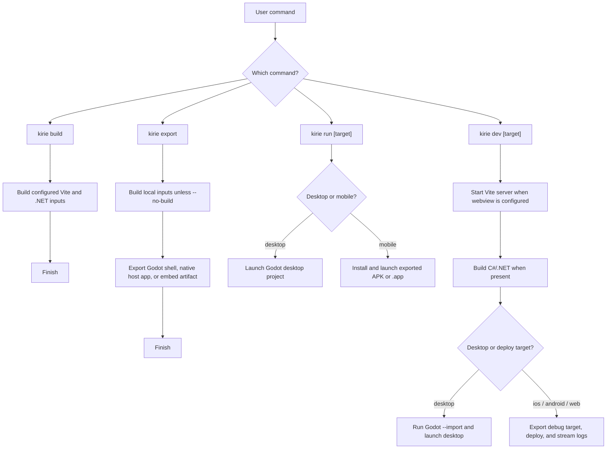

# Architecture Notes

Kirie is an application framework built around a low-level Godot WebView addon, a typed IPC core, and optional native mobile shell integration. Projects can run as Godot-owned applications (`host: "godot"`) or inside SwiftUI and Android host applications (`host: "native"`) that embed Godot. Higher-level protocols, host capabilities, and CLI workflows live in packages above the low-level core.

The low-level addon and IPC core provide:

- a Godot-facing `GdKirie` service
- a scene-tree `KirieNode` owner
- a thin C# `KirieClient` wrapper for .NET projects
- Android and iOS native WebView implementations
- a desktop Godot CEF backend
- an iframe backend for Godot Web exports
- packaged `res://` web resource loading for exported applications
- a repository-level platform integration test project

Application-framework behavior such as CLI workflows, host capabilities, export orchestration, native mobile embedding, and mobile development sessions lives above that core. `@gd-kirie/ipc` wraps the browser-side platform bridge across mobile WebViews, desktop Godot CEF, and same-origin Web iframes. Eventa adapters and Platform capability packages sit above Kirie and use its text IPC transport or the native `KirieHost` bridge.

Mobile WebView IPC keeps Kirie core byte-oriented and CBOR-based across explicit `text`, `binary`, and `data` lanes. Android carries CBOR packets through AndroidX WebKit ArrayBuffer message channels. iOS carries CBOR packets as base64 strings through WKWebView script messages with matching lane payload semantics.

## Current Godot API direction

`kirie` is the low-level WebView and IPC bridge.

Higher-level semantics such as event routing, richer message contracts, or
request/response abstractions are expected to live above this layer, for example
in future app-specific adapters above Kirie or `@gd-kirie/ipc`.

Current public Godot-facing names should stay close to that low-level role:

- `create_webview(options := {})`
- `destroy_webview()`
- `load_url(url)`
- `load_html_string(html, base_url := "")`
- `send_text(message)`
- `send_binary(bytes)`
- `send_data(value)`
- `get_launch_option(key)`
- `grant_permission(request_id)`
- `deny_permission(request_id)`

These names describe the current low-level transport API. Android implements
the lane shape with AndroidX WebKit ArrayBuffer message channels and CBOR
packets. iOS implements the same text, binary, and data lanes with CBOR packets
carried as base64 strings through WKWebView script messages.
Web implements these lanes with a transferred `MessagePort` and structured clone.

The Godot-facing `Kirie` script stays a thin wrapper over the native singleton,
desktop CEF node, or Web DOM session.
Each backend owns its platform lifecycle and serialization behavior.

The C# `KirieClient` wrapper follows the same low-level surface. Its default
constructor forwards to the platform singleton, while `FromNode(...)` borrows
an existing scene `KirieNode` so C# can retain a typed API without creating a
second WebView owner. Methods use C# naming, and Kirie signals are exposed as C#
events. Internal Godot `Callable` usage exists only inside this wrapper. A
borrowed node must outlive the client; disposing the client disconnects its
callbacks but leaves node and WebView ownership with `KirieNode`.
The wrapper derives from Godot `RefCounted`. Disposal also releases its own
native wrapper object.

`KirieNode` forwards its effective CanvasItem visibility, including initial and ancestor visibility, to the existing WebView.
This follows the [Godot visibility contract](https://docs.godotengine.org/en/stable/classes/class_canvasitem.html#class-canvasitem-signal-visibility-changed).
Android changes the native View visibility on the UI thread.
iOS changes the container UIView visibility on the main actor.
Desktop CEF uses Control visibility and disables its input processing while hidden.
Web changes iframe visibility without replacing the DOM element or MessagePort.
Hide and show preserve the loaded page, readiness, and transport.
Hidden views suppress user input and forwarded pointer events.

Current signals should also stay narrow:

- `webview_ready`
- `text_received`
- `binary_received`
- `data_received`
- `permission_requested`
- `ipc_error`

The Godot-facing scripts are authored in `packages/kirie/src-godot` and
converted to Git-ignored GDScript in `packages/kirie/addon/addons/kirie`.
The generated paths and `class_name` declarations remain the public Godot
interface. TypeScript source does not ship in the addon zip.

Desktop permission requests remain pending until the application grants or
denies each request ID. Kirie only forwards the permission type, requesting
origin, and request ID. The application owns the trust policy and must resolve
unknown permission types and untrusted origins by denying them. This keeps the
low-level API independent of Godot CEF while avoiding a global allow policy.

Higher-level invocation APIs do not enter Kirie core. Confirmed application
capabilities are implemented above it through packages such as Platform, Tray,
Notifications, and QR.

For the current milestone, Kirie should treat `KirieNode` as the public
scene-tree ownership unit for a platform WebView. A user may place a
`KirieNode` under the main scene, under a Godot `Window` node, or in another
scene structure that fits their project.

Kirie core does not own window organization. Prefab windows, panels,
workspaces, cross-view forwarding, and routing remain application concerns
above the low-level WebView and IPC surface. Do not create a general
BrowserWindow facade or add these capabilities to GDScript.

## Platform capability layer

The Platform layer exposes host-owned capabilities that standard Web APIs do not provide. Its dependency direction is:

```text
@gd-kirie/platform -> @gd-kirie/ipc-eventa -> @gd-kirie/ipc
GdKirie.Platform -> GdKirie.EventaAdapter
```

The browser client borrows an application-owned `KirieEventaContext`. `GdKiriePlatform.Attach(context, hostWindow, windowBackend)` registers the matching Eventa contract on that context and binds its lifetime to one explicit Godot `Window`. Neither package creates a competing IPC owner.

`GdKirie.Platform` separates window-owned operations behind `IKirieWindowBackend`. When `windowBackend` is `null` and `!hostWindow.IsEmbedded()`, `Attach` creates the internal `GodotWindowBackend`. When `hostWindow.IsEmbedded()` is `true` and `windowBackend` is `null`, `Attach` still succeeds and registers operating-system, Back, and shortcut capabilities. Window-owned invokes throw `PlatformNotSupportedException` on an embedded window unless the caller supplies an `IKirieWindowBackend` implementation.

Host-owned mobile shells (`host: "native"`) can run Eventa RPC without a WebView. `KirieHostTextTransport` in `GdKirie.Platform` implements `IKirieTextTransport` over the native `KirieHost` Godot singleton. It listens to the `host_message_received` signal and marshals `SendText` calls to `send_to_host` on the Godot main thread.

The implemented Platform capabilities are:

- opening absolute HTTP and HTTPS URLs with the system browser
- opening the active Godot user data directory
- host-window bounds snapshots in screen coordinates
- current-display bounds snapshots in screen coordinates
- unscaled pixel pointer snapshots and change events relative to the host window
- pointer passthrough
- native move and resize gestures
- always-on-top state
- centering on the current display
- system-wide global shortcuts on macOS and Windows
- [Android system Back requests](decisions/0005-add-android-system-back-to-the-platform-layer.md)

Global shortcuts use Godot logical keys with explicit register and unregister calls. The browser receives `pressed` and `released` states through one `onKeyEvent` handler while the Godot window is hidden or unfocused. Registration lifetime belongs to `GdKiriePlatformHost`. macOS uses Carbon hot-key registration, and Windows shares one lazy `WH_KEYBOARD_LL` hook across Platform hosts, as recorded in [ADR-0003](decisions/0003-use-a-low-level-keyboard-hook-for-windows-global-shortcuts.md). Platform does not yet implement a Linux global-shortcut backend.

Android system Back forwards `Window.GoBackRequested` from the bound window. Browser code subscribes to the exported `backRequested` contract and decides whether Back changes the route or closes the application. If the application handles Back, set `SceneTree.quit_on_go_back` to `false`, as recorded in [ADR-0005](decisions/0005-add-android-system-back-to-the-platform-layer.md).

## Tray plugin

The Tray packages and native extension are maintained in
[kirie-plugins](https://github.com/gd-kirie/kirie-plugins).

The plugin keeps native tray and menu objects separate from browser transport:

```text
@gd-kirie/tray -> @gd-kirie/ipc-eventa -> @gd-kirie/ipc
GdKirie.Tray.EventaAdapter -> GdKirie.EventaAdapter
GdKirie.Tray.EventaAdapter -> GdKirie.Tray -> Rust GDExtension -> tray-icon / muda
```

The C# SDK works without WebView or Eventa. The optional Eventa adapter borrows
the application's context and forwards browser operations to the SDK.
Both APIs ship in the `GdKirie.Tray` NuGet package.
The npm plugin installs that package and the `addons/kirie_tray` GDExtension.

API, ownership, and platform behavior are documented in
[kirie-plugins](https://github.com/gd-kirie/kirie-plugins/blob/main/packages/tray/README.md).
The [forwarding decision](https://github.com/gd-kirie/kirie-plugins/blob/main/docs/decisions/0001-keep-tray-a-thin-forwarding-layer.md)
is maintained with the plugin.

The public API is independent of Uninvoke. Any Uninvoke-specific names, event
IDs, compatibility behavior, or unsupported-method policy belong in the
Uninvoke repository's Kirie adapter. Application lifecycle, display
enumeration, arbitrary shell or process execution, a general operating-system
permission API, updater behavior, multi-window factories, and general
capability discovery remain outside this milestone.

`@gd-kirie/platform` is the application capability SDK. It must not be confused
with the existing `window.kirie.platform` value and TypeScript
`KiriePlatform` interface in `@gd-kirie/ipc`; those identify the native OS and
low-level WebView backend and are not capability objects.

## Notifications plugin

The Notifications packages and export adapter are maintained in
[kirie-plugins](https://github.com/gd-kirie/kirie-plugins).

`@gd-kirie/notifications` and `GdKirie.Notifications` borrow the application's
existing Eventa context and expose immediate notifications with live click
activation. The fixed dependency direction is
`@gd-kirie/notifications -> @gd-kirie/ipc-eventa -> @gd-kirie/ipc` and
`GdKirie.Notifications -> GdKirie.EventaAdapter`.

macOS and Windows use the implementations moved from Platform. Android and iOS
call the pinned `godot-notification-scheduler` v6.0 native singleton. The
addon-rooted export adapter injects its AAR or XCFramework and export metadata;
it does not add a second notification implementation or a project-root
`ios/plugins` shim. IDs remain caller-owned strings, activations route only to
the live host that published them, and richer scheduling APIs remain outside
the current contract. This boundary is recorded in
[ADR-0014](decisions/0014-extract-notifications-into-a-kirie-plugin.md).

## QR plugin

The optional [QR plugin](https://github.com/gd-kirie/kirie-plugins/blob/main/packages/qr/README.md)
borrows the application's Eventa context and KirieNode.
It hides the existing WebView while Godot shows the camera preview.
Core provides WebView visibility forwarding; camera ownership, permissions, and native dependencies stay in the QR plugin.

## Scene ownership and resources

Windows pointer passthrough is the one initial native exception. Godot's current
Windows hit-test path returns `HTTRANSPARENT`, whose forwarding scope is limited
to windows in the same thread. `GdKirie.Platform` therefore changes the bound
window's layered/transparent extended styles through P/Invoke so pointer hits
can reach other applications. Other platforms use Godot's window API directly.

The public Godot API should primarily let users address WebViews through node
references:

- `$KirieNode.load_url(url)`
- `$KirieNode.send_text(message)`
- `$KirieNode.send_binary(bytes)`
- `$KirieNode.send_data(value)`

Native implementations may keep internal handles or IDs to manage platform instances.
Android and iOS use private view IDs only to route callbacks back to the owning `KirieNode`; public routing names, browser-driven cross-view forwarding, and window helper APIs are deferred higher-level concerns.

Kirie supports loading packaged offline web content from Godot project
resources. The current native resolvers can serve packaged `res://` paths. The
Kirie CLI app layout standardizes production web content at
`res://src-web/dist/index.html`, as described below.

## Runtime debug configuration and export flags

Godot export preset flags control debug behavior in exported WebView applications:

- `kirie/debug/enable_web_inspector`
- `kirie/debug/allow_tls_bypass`

On Android, the export plugin writes these flags as application manifest metadata for the native plugin. On iOS, the export plugin writes matching `Info.plist` entries and injects App Transport Security overrides only when `kirie/debug/allow_tls_bypass` is `true`.

Android WebView exports resolve `moe.gdkirie.kirie:core:<version>` from Maven Central by default. Run `mise run build:android-aar` to publish `<version>-local` to Maven Local, and pass `-- --kirie-android-maven-local` to select that local artifact. Pass `-- --kirie-android-extra-args=<arguments>` to override `command_line/extra_args` for a single Android export without modifying `export_presets.cfg`.

The CLI also passes two user flags to the Kirie `EditorExportPlugin` during headless Godot exports. `--kirie-plugins=<comma-separated-ids>` tells the export plugin which Kirie plugins are active. When `--kirie-plugins` omits `webview`, the export plugin skips all WebView native dependencies, C++ glue, `Info.plist` keys, and web asset staging. Omitting `--kirie-plugins` during Godot Editor GUI exports preserves WebView export behavior. `--kirie-web-dist=<path>` overrides the built Vite asset directory packed or staged into `res://src-web/dist`.

## Kirie app layout and CLI direction

A Kirie project combines a Godot project with `kirie.config.ts` and an optional Vite frontend:

```text
kirie.config.ts
package.json
pnpm-lock.yaml / bun.lock / package-lock.json
project.godot
src-godot/
  main.tscn
  main.gd or main.cs
src-web/
  index.html
  src/
  assets/
  dist/
addons/
  kirie/
  godot_cef/
  others/
.kirie/
  embed/
```

Directory and package responsibilities are:

- `src-godot`: Godot scene and script sources
- `src-web`: optional Vite frontend source and `dist` build output when `webview(...)` is active
- `addons`: Godot plugins such as `addons/kirie` and desktop `addons/godot_cef`
- `.kirie`: Git-ignored CLI staging output for `host: "native"` mobile embed builds
- `kirie.config.ts`: mandatory project configuration for all CLI commands except `kirie init`
- `@gd-kirie/build`: programmatic build, export, and native-embed staging API usable without the CLI

Godot-owned targets (`host: "godot"`) keep native code inside Godot plugins under `addons/` and never generate Capacitor-style `ios/` or `android/` trees inside the Godot project. Native-shell targets (`host: "native"` on `ios` and `android`) reference a user-owned Xcode or Gradle application through `targets.<platform>.project` while Kirie stages generated Godot artifacts under `.kirie/embed/`.

### Configuration and built-in plugins

Every CLI command except `kirie init` loads `kirie.config.ts` through Node.js 24 native TypeScript `import()`. Configuration files can export an object, a `Promise`, or a `({ command, mode }) => ...` factory with `defineKirieConfig` from `kirie`. Only `godot`, `plugins`, and required `targets` are valid top-level keys. Legacy top-level `web` fails fast with a migration hint to `webview({ root })` from `kirie/plugin/webview`.

```ts
import { defineKirieConfig } from "kirie";
import core from "kirie/plugin/core";
import webview from "kirie/plugin/webview";

export default defineKirieConfig({
  plugins: [
    core,
    webview({ root: "./src-web" }),
  ],
  targets: {
    desktop: { host: "godot" },
    ios: { host: "godot" },
  },
});
```

Built-in plugin responsibilities split cleanly between C# host packages and WebView assets:

- `kirie/plugin/core` (`id: "core"`): declares the `GdKirie.EventaAdapter` and `GdKirie.Platform` NuGet packages, which `kirie doctor` skips when the Godot project has no `.csproj` file
- `kirie/plugin/webview` (`id: "webview"`): accepts `webview({ root, vite })`, configures the Vite frontend, and declares `addons/kirie` plus `addons/godot_cef` (scoped to `targets: ["desktop"]`)

`vite` is an optional peer dependency of both `kirie` and `@gd-kirie/build`. The CLI imports `vite` dynamically only when `webview(...)` is present in `plugins`, so WebView-free projects run without `vite` installed.

### Shell modes and native mobile embed pipeline

Each configured entry in `targets` (`desktop`, `ios`, `android`, `web`) requires an explicit `host` mode. `desktop` and `web` support `host: "godot"` with an optional `preset` name. `ios` and `android` support both `host: "godot"` and `host: "native"`.

In `host: "godot"` mode, Godot owns the exported application shell. In `host: "native"` mode, `@gd-kirie/build` stages an embeddable Godot bundle in `.kirie/embed/<ios|android>/<debug|release>/` without touching `<godot.project>/android/build`:

- `.kirie/embed/ios/<mode>/`: stages `ios-*` `.xcframework` bundles in `Frameworks/`, `Resources/<Executable>.pck`, `Sources/KirieGodotPlugins.mm`, `Sources/KirieHostBridge.mm`, `Sources/KirieGodotView.swift`, and `KirieEmbed.xcconfig` (`WebKit` links only when `Kirie.framework` is staged)
- `.kirie/embed/android/<mode>/`: stages `godot-embed-<mode>.aar` (with `org.godotengine.godot` resources, manifest providers, and `.NET 10` runtime `.so` and `.jar` files), `libs/`, `Sources/`, and `godot-build/`
- `KirieHostBridge.mm` (via ClassDB on iOS) and `KirieHostPlugin.kt` (via `GodotPlugin` on Android): register the `KirieHost` singleton (`send_to_host` and `host_message_received`) for `KirieHostTextTransport`

Native mobile targets support App mode and Artifact mode through `targets.<platform>.project`. In App mode, `project` is set on `targets.ios` (with optional `scheme`) or `targets.android` (with optional `module`, `:app` by default). `kirie dev` and `kirie export` stage `.kirie/embed/...` and build the native host application through incremental `xcodebuild -derivedDataPath` or Gradle `assemble<Mode>`. `kirie dev` and `kirie run` resolve `CFBundleIdentifier` or the launcher `Activity` from the built output to install and launch the host application.

In Artifact mode, `project` is omitted on `targets.ios` or `targets.android`. `kirie export ios` and `kirie export android` copy the staged embed bundle and `kirie-embed-manifest.json` to `dist/kirie/<platform>/<mode>/` for external build systems. `kirie dev` and `kirie run` reject Artifact mode because no host application project is configured.

### CLI commands and target selection

The public CLI exposes six top-level commands (`init`, `doctor`, `build`, `dev`, `export`, `run`):

```sh
kirie init <dir> <template> [--overwrite]
kirie doctor [desktop|ios|android|web|plugin:<id>] [--fix]
kirie build [web|dotnet]
kirie dev [desktop|android|ios|web]
kirie export <desktop|android|ios|web>
kirie run [desktop|android|ios]
```

When `targets` declares one target, bare `kirie dev` and `kirie run` select that sole target automatically. When `targets` declares two or more targets, bare `kirie dev` and `kirie run` fail fast and require an explicit target name such as `kirie dev desktop` or `kirie run desktop`. `kirie export` always requires a platform subcommand (`desktop`, `android`, `ios`, or `web`).



`kirie init <target> <template> [--overwrite]` scaffolds a project from `templates/<template>` at the pinned `moeru-ai/kirie-templates` commit in `packages/cli/src/commands/init.ts`. It updates `package.json.name` and, when `src-web/index.html` exists, sets `<title>`. After initialization, run `pnpm install` and `pnpm kirie doctor --fix`.

`kirie doctor` runs read-only environment, target, and plugin diagnostics. `kirie doctor [desktop|ios|android|web]` scopes diagnostics to one configured target, and `kirie doctor plugin:<id>` scopes diagnostics to one configured plugin. Passing `--fix` installs missing Godot addons and NuGet packages and repairs supported `export_presets.cfg` fields through a headless Godot `ConfigFile` script rather than text patching:

| Diagnostic item | Purpose | Required behavior |
| --- | --- | --- |
| Kirie plugin dependencies | Match configured Godot addons and .NET packages against plugin descriptors. | Fail when a required dependency is missing or mismatched, and suggest `kirie doctor --fix plugin:<id>`. |
| Godot command | Run the configured Godot executable and detect its version. | Probe `--version` and report the detected version or execution error. |
| Godot export templates | Locate installed export templates for the detected Godot version. | Inspect the Godot template directory without downloading engine templates automatically. |
| Target prerequisites | Inspect Android SDK, Java path, Xcode schemes, Gradle wrappers, and presets for configured targets. | Report missing SDKs, presets, or required preset flags for each active target. |

`kirie build` builds configured Vite web assets (when `webview(...)` is active) and compiles the Godot C# project when a `.csproj` file exists. `kirie build web` builds only Vite output and fails if `webview(...)` is absent. `kirie build dotnet` builds only the C# project and fails if no `.csproj` file exists.

`kirie export <desktop|android|ios|web>` builds local inputs unless `--no-build` is set, then packages the selected target (`debug` by default, or `release` with `--release`). On `ios` (`host: "godot"` or `host: "native"` App mode), `kirie export ios` builds a simulator `.app` by default or a signed device `.app` when `--device <UDID>` selects a physical device. On `web`, `kirie export web` exports the Godot Web preset and copies the Vite `dist` tree to sibling `src-web/dist`.

`kirie run` launches Godot directly on `desktop` and forwards user arguments after `--`. On `android` and `ios`, `kirie run` installs and launches the exported APK or `.app` (`--skip-install` on Android skips reinstallation).

`kirie dev` runs headless `godot --import` first so fresh checkouts register `class_name` scripts before scene parsing. When `webview(...)` is configured, `kirie dev` starts the Vite server and injects launch arguments:

```text
--kirie-dev=1
--kirie-web-url=http://127.0.0.1:<actual-port>/
```

On Android, `kirie dev android` runs `adb reverse tcp:<actual-port> tcp:<actual-port>` and passes those keys as intent extras (`permissions/internet=true` is required when `host: "godot"` uses `webview`). On iOS Simulator, `kirie dev ios` passes them as `simctl` process arguments and streams `tmp/kirie.log`. On a physical iOS device (`kirie dev ios --device <UDID>`), Vite binds to `0.0.0.0` and injects a LAN URL. When `webview(...)` is omitted, `kirie dev` skips Vite and launches the Godot or native mobile host directly.

`webview({ root, vite })` owns the base Vite invariants while letting `vite` extend plugins, aliases, defines, CSS, Rollup configuration, and server proxies:

```text
root = webview.root
base = "./"
server.host = "127.0.0.1"
server.port = 5173
server.strictPort = false
server.open = false
build.outDir = "dist"
```

User `vite` configuration in `webview({ root, vite })` cannot override `root`, `base`, `server.host`, `server.port`, `server.open`, or `build.outDir`. Single-run CLI flags on `kirie dev` (`--project`, `--godot`, `--host`, `--port`, `--strict-port`, `--mode`, `--force`, `--log-level`, `--clear-screen`, `--no-clear-screen`, `--device`, and arguments after `--`) supply runtime overrides.

## Packaged web resource loading

`res://` web loading serves resources packaged inside the exported application. Android resolves `res://` URLs against APK or AAB assets, and iOS resolves `res://` URLs against the `.app` bundle. Runtime-mounted Godot packs are outside this path, and `http://`, `https://`, and `file://` URLs use default platform WebView loading.

Production web content lives at `res://src-web/dist/index.html`. When `webview` is active, the addon export plugin stages `res://src-web/dist` (or `--kirie-web-dist`) into Desktop, Android, and iOS exports. The export fails if `index.html` is missing. On Web exports, `kirie export web` copies the Vite output beside the Godot HTML page at `src-web/dist`, where the iframe backend maps `res://src-web/dist` to that same-origin path. Legacy `res://web` paths are not supported, and runtime `build`, `export`, and `run` commands never mutate `export_presets.cfg`.

## Desktop Godot CEF direction

Kirie now treats Godot CEF as the desktop WebView and IPC backend compatibility
target. The first desktop target is macOS. Windows and Linux should follow the
same shape once macOS works, but iOS and Android continue to use their platform
WebView implementations.

This work is scoped to Kirie's current low-level WebView and IPC surface:

- `create_webview`
- `destroy_webview`
- `load_url`
- `load_html_string`
- `send_text`
- `send_binary`
- `send_data`
- `webview_ready`, `text_received`, `binary_received`, `data_received`, and
  `ipc_error`

Do not expose Godot CEF's full browser-control API as Kirie API just because the
desktop backend can do it. If Kirie later adopts more of the Godot CEF IPC
surface, add each capability only when there is a cross-platform plan for the
Android WebView and iOS WKWebView backends.

The `@gd-kirie/ipc` browser package should not detect backend implementation
details such as `window.sendIpcMessage` or Android channel object names. It
should select its transport from the Kirie runtime platform object:

```ts
interface KiriePlatform {
  os: "android" | "ios" | "macos" | "windows" | "linux";
  backend: "webview" | "wkwebview" | "godot-cef";
}

interface KirieRuntime {
  platform: KiriePlatform;
}

interface Window {
  kirie?: KirieRuntime;
}
```

The runtime object belongs to Kirie, not to Godot CEF. Godot CEF currently
documents renderer-side IPC globals such as `window.sendIpcMessage`,
`window.sendIpcBinaryMessage`, and `window.sendIpcData`, but not a stable
platform-information object.

Desktop Godot CEF binaries are external downloaded artifacts rather than files bundled inside the `kirie` npm package. The `kirie/plugin/webview` descriptor owns the pinned Godot CEF version and SHA-256 checksum, scoped to `targets: ["desktop"]`. When `desktop` and `webview` are active and `addons/godot_cef` is missing, desktop `dev` and `export` fail before running Godot and print `pnpm kirie doctor --fix plugin:webview`. Android, iOS, and Web workflows do not require Godot CEF.

Downloaded Godot CEF addons install into the standard Godot addon path:

```text
addons/godot_cef/
```

Godot loads the Godot CEF GDExtension from that path, and Git ignores project instances of `addons/godot_cef/`. The CLI downloads the pinned archive, makes sure that its SHA-256 checksum and archive layout match, installs it atomically, and records the checksum in `.godot/kirie/godot-cef.sha256`. `kirie doctor` compares that local cache against the pinned checksum without downloading again, and `--fix` replaces the addon when the checksum differs:

```sh
pnpm kirie doctor --fix plugin:webview
```

In this repository, the root mise task runs that command against a target Godot project directory:

```sh
mise run install:godot-cef <godot-project-dir>
```

## JavaScript runtime injection

Kirie browser-side code requires one invariant:

```text
Kirie initializes the JavaScript global before any user page script runs.
```

The injected runtime must be small and must not depend on the DOM. It should only
require `globalThis` or `window`:

```js
globalThis.kirie ??= {};
globalThis.kirie.platform = Object.freeze({
  os: "macos",
  backend: "godot-cef",
});
```

The platform mapping for this pre-page-script injection is:

- Android: `WebViewCompat.addDocumentStartJavaScript`, registered before
  `loadUrl`, `loadData`, or `loadDataWithBaseURL`. Android documents this as a
  document-beginning script that runs before page JavaScript, while the DOM tree
  might not be ready.
- iOS: `WKUserScript` with `WKUserScriptInjectionTime.atDocumentStart`, added to
  the `WKWebView` loads content. Apple
  documents this as after creation of the webpage document element but before
  loading other content.
- Godot CEF: set `CefTexture.preload_script` or `preload_script_path` before the
  `CefTexture` node enters the scene tree or before its browser is otherwise
  initialized. Godot CEF documents this as running after its built-in JavaScript
  bridge is registered and before the document loads.

Godot CEF's public Godot-facing API also documents `eval(code)`, but `eval`
executes JavaScript in the browser's main frame after the page exists. Do not use
`eval` for Kirie's runtime initialization because it cannot guarantee that the
runtime is available before the user's module bundle runs.

This mirrors established desktop WebView framework patterns. Electron uses a
preload script that runs before the page is loaded and is commonly used to
expose renderer IPC APIs. Tauri exposes initialization scripts whose documented
timing is after the global object is created but before the HTML document is
parsed and before scripts in the HTML run; it also documents an Android fallback
that prepends initialization scripts to each HTML head when document-start
support is unavailable. Wails serves `index.html` with injected IPC and runtime
scripts. Kirie's HTML rewrite is therefore an intentional first step, not the
final preferred backend hook.

## iOS packaging direction

The native iOS backend requires iOS 16 or later. Application export presets
must use the same minimum version or a later version.

For the current milestone, iOS should follow the same addon-centered shape as
Android:

- users consume `addons/kirie`
- produced addon trees include `addons/kirie/ios/Kirie.debug.xcframework` and
  `addons/kirie/ios/Kirie.release.xcframework`
- the addon export plugin injects the xcframework, system frameworks, plist
  content, and native initialization glue through Apple export hooks
- example projects should not carry a separate `res://ios/plugins` shim

This is aligned with Godot's iOS plugin model in behavior, while keeping Kirie's
install shape addon-centered:

- Godot's iOS plugin guide defines a native iOS plugin as a static library or
  static-library `.xcframework` with Godot headers, initialization and
  deinitialization entry points, matching Godot compile flags, optional debug
  and release variants, and a `.gdip` descriptor.
- Kirie keeps the same native binary and entry-point model, but does not rely on
  `.gdip` auto-discovery under `res://ios/plugins`. The addon export plugin owns
  discovery and injects the selected framework, plist content, bundle resources,
  and initialization glue through `EditorExportPlugin` Apple embedded platform
  hooks.
- Kirie builds `Kirie.debug.xcframework` from the `ReleaseDebug` configuration
  and `Kirie.release.xcframework` from the `Release` configuration. The
  `ReleaseDebug` naming follows the upstream Godot iOS plugins repository,
  which documents that official debug export templates are compiled with
  `release_debug`, not the full `debug` target.
- Native iOS Godot-facing classes should be registered through ClassDB and bind
  their signals in `_bind_methods` with `ADD_SIGNAL`. This keeps signal metadata
  in Godot's normal object system instead of maintaining a separate callback
  registry in Kirie.

The official iOS plugin documentation still describes `res://ios/plugins`
because that is Godot's automatic plugin discovery path. Kirie's exception is
only the packaging location and activation mechanism; the binary ABI, build
flags, entry points, and exported Xcode integration remain based on Godot's
iOS plugin and Apple embedded platform export APIs.

## GitHub Release addon flow

GitHub Release addon publishing is configured through the `Addon Release`
workflow. Keep it separate from npm package publishing. The npm packages contain
browser APIs and CLI tools. Optional Tray, Notifications, and QR
packages are built and published from kirie-plugins.

The release artifact shape and workflow modes live in
[Addon Release](./addon-release.md).

The .NET Eventa adapter and Platform host use a separate NuGet release lane.
The Tray, Notifications, and QR hosts are published from kirie-plugins.
Keep NuGet publishing separate from addon zip publishing and npm publishing.

## IPC and adapter split

Kirie IPC is moving from the previous JSON-shaped message path to explicit
`text`, `binary`, and `data` lanes. Android currently implements this lane shape
over byte-oriented CBOR packets:

- text payloads are CBOR text strings
- binary payloads are CBOR byte strings
- data payloads are a constrained cross-platform data subset: null, booleans,
  numbers, strings, arrays, and maps with string keys

Godot objects, nodes, callables, RIDs, symbols, functions, custom classes,
cycles, dates, regular expressions, and other engine-local or JavaScript-local
values are out of scope for the data lane.

### Godot Web iframe backend

Web exports keep the same `KirieNode` owner and lane API. C# borrows that owner
through `KirieClient.FromNode()`.

The DOM adapter creates, sizes, navigates, and destroys a same-origin iframe.
It transfers a private `MessagePort` after each document load. It must not grow
container APIs, serialization, application protocols, or another JavaScript
runtime. Those responsibilities stay in their existing packages.

The Godot backend uses official
[JavaScriptBridge](https://docs.godotengine.org/en/stable/classes/class_javascriptbridge.html)
APIs. It performs the one required recursive conversion between Godot Variant
containers and native JavaScript containers. Web lane traffic uses structured
clone through the transferred port. Eventa remains an adapter above Kirie IPC.

The Web backend supports same-origin content only. It maps
`res://src-web/dist` to the Vite build beside the exported Godot page. Other
`res://` roots are unavailable to the browser.

C# Web support uses the experimental templates from
`gd-kirie/godot-dotnet-web-templates`. `kirie doctor --fix web` installs and
validates them without installing another Godot editor or writing machine-local
paths into the project. The template
repository owns their build and release workflow. The templates use WebAssembly
threads, so served Web content must be cross-origin isolated; `kirie dev web`
supplies the isolation headers for development.

### Data lane type mapping

The data lane keeps one semantic subset across the browser, Godot wrappers, and
Android native code, but each layer uses its own host-language representation:

| Data lane value | TypeScript `@gd-kirie/ipc` | Godot GDScript | Godot C# | Android Kotlin after bridge |
| --- | --- | --- | --- | --- |
| null | `null` | `null` / `TYPE_NIL` | `Variant.Type.Nil` | `null` |
| boolean | `boolean` | `bool` / `TYPE_BOOL` | `Variant.Type.Bool` | `Boolean` |
| integer | `number` | `int` / `TYPE_INT` | `Variant.Type.Int` | `Long` |
| float | `number` | `float` / `TYPE_FLOAT` | `Variant.Type.Float` | `Double` |
| string | `string` | `String` / `TYPE_STRING` | `Variant.Type.String` | `String` |
| array | `KirieData[]` | `Array` / `TYPE_ARRAY` | `Variant.Type.Array` | `Array<*>` |
| map/object | `{ [key: string]: KirieData }` | `Dictionary` / `TYPE_DICTIONARY` | `Variant.Type.Dictionary` | `Dictionary` |

The public Godot API stays Variant-shaped: GDScript exposes
`send_data(value: Variant)`, and C# exposes `SendData(Variant value)`. Android
does not expose a single Kotlin `Any?` entrypoint for all data lane values,
because Godot's Android plugin bridge registers JVM parameter types for
conversion. A Kotlin `Any?` parameter becomes `java.lang.Object`; Godot treats
that as a Java object parameter, not as a general Variant parameter. A Kotlin
`Array<Any?>` parameter becomes JVM `Object[]`; Godot treats that as a typed
JavaObject array, not as a heterogeneous Godot `Array`.

The Godot wrappers therefore validate the root `Variant` kind, place the value
under a private `Dictionary` key, and call one Android `sendData(Dictionary)`
method. The Android plugin unwraps that key immediately before CBOR encoding.
The `Dictionary` exists only at the Godot Android bridge boundary; it is not the
data lane protocol shape, and it does not force CBOR values to be map roots.
Root `null`, scalar, array, and map values are still encoded as their original
CBOR data item.

The relevant Godot 4.7.1 stable sources are
[`GodotPlugin.java`](https://github.com/godotengine/godot/blob/a13da4feb8d8aefc283c3763d33a2f170a18d541/platform/android/java/lib/src/main/java/org/godotengine/godot/plugin/GodotPlugin.java#L129-L161)
method registration,
[`godot_plugin_jni.cpp`](https://github.com/godotengine/godot/blob/a13da4feb8d8aefc283c3763d33a2f170a18d541/platform/android/plugin/godot_plugin_jni.cpp#L72-L91)
native method registration,
[`java_class_wrapper.cpp`](https://github.com/godotengine/godot/blob/a13da4feb8d8aefc283c3763d33a2f170a18d541/platform/android/java_class_wrapper.cpp#L118-L128)
Java object argument validation,
[`java_class_wrapper.cpp`](https://github.com/godotengine/godot/blob/a13da4feb8d8aefc283c3763d33a2f170a18d541/platform/android/java_class_wrapper.cpp#L224-L255)
array argument validation, and
[`jni_utils.cpp`](https://github.com/godotengine/godot/blob/a13da4feb8d8aefc283c3763d33a2f170a18d541/platform/android/jni_utils.cpp#L158-L211)
Variant container conversion.

The browser-side `@gd-kirie/ipc` package uses `cborg` for CBOR. Android native
code uses Jackson CBOR because it provides a dynamic `JsonNode` tree for the
data lane; Kotlinx Serialization CBOR is schema-first and is not used for the
dynamic data lane. Android converts `JsonNode` values into Godot-compatible JVM
objects before emitting Godot signals. Do not add a GDScript CBOR codec for this
path.

Godot CEF is a learning reference and future compatibility target because it
separates `ipc_message`, `ipc_binary_message`, and `ipc_data_message`, with its
data lane documented as CBOR-backed.

Eventa remains above Kirie. `@gd-kirie/ipc-eventa` and `GdKirie.EventaAdapter` support event emission and unary request-response RPC over Kirie text IPC. Their JSON messages are adapter encodings rather than Kirie core payload types. Treat `moeru-ai/eventa` and `moeru-ai/eventa.net` as upstream Eventa projects, and do not modify them unless an adapter exposes an upstream defect.

`GdKirie.EventaAdapter` lives under `packages/GdKirie.EventaAdapter` in `GdKirie.slnx`. Its NuGet package packs `content/KirieClientEventaBridge.cs` together with `build/GdKirie.EventaAdapter.targets` and `buildTransitive/GdKirie.EventaAdapter.targets`. When `$(MSBuildProjectDirectory)/addons/kirie/csharp/KirieClient.cs` exists in a direct or transitive consumer (or when `EnableKirieClientEventaBridge` is `true`), MSBuild compiles `KirieClientTextTransport` and `KirieClient.CreateEventaContext(...)` without putting Eventa files inside `addons/kirie`. WebView-free C# projects and class libraries without `KirieClient.cs` (or with `EnableKirieClientEventaBridge=false`) compile without bridge errors.

`GdKirie.EventaAdapter` targets `net10.0` only. Projects that target `net8.0` or `net9.0` fail during restore or build when they reference it. Do not copy Eventa protocol logic into Kirie to bypass the upstream Eventa .NET target framework.

Any future binary or structured Eventa transport must start as an explicit opt-in entry point before changing the default text transport. That transport must use the CBOR-backed `data` or `binary` lane directly instead of wrapping another JSON string. It must also document payload restrictions from the cross-platform data subset.
